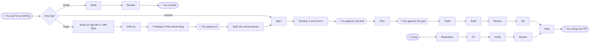

# ourkit

Think of ourkit as a senior teammate you install into your project. It makes Claude Code stop, ask, plan, test and get a second opinion before anything lands, instead of happily rewriting half your codebase because you said "quick fix".

It does all the work up to the pull request. **Merging and deploying to production stay with you.** It won't touch either, no matter how nicely anyone asks.



You need Claude Code, plus Node 18 or later for the install. Each word in **bold** below is explained the first time it shows up.

**Jump to:** [Set it up](#set-it-up) · [Cheat sheet](#cheat-sheet) · [A normal change, step by step](#a-normal-change-step-by-step) · [Bugs, small fixes and huge things](#bugs-small-fixes-and-huge-things) · [Never get lost](#never-get-lost) · [Let it work without you](#let-it-work-without-you) · [Connect GitHub](#connect-github) · [Make it yours](#make-it-yours) · [Things to know](#things-to-know)

## Set it up

The repo is private, so your machine needs access to it.

**1. Install.** In your project's folder:

```
npx github:LanHuong142002/ourkit
```

It asks two things; pick with the arrow keys and Enter:

- **New or existing project?** If there's code already, pick existing. ourkit then leaves your old code alone and only judges what you change from now on.
- **Which Roles?** A **Role** is extra know-how plus a review checklist for one kind of work: `backend`, `frontend`, both, or none.

Don't like questions? `--entry new|existing --roles backend,frontend|full-stack|none`.

**2. Commit** everything it added, in a commit of its own. Teammates who clone the project get the same setup for free. It also marks the kit's files as generated in `.gitattributes`, so GitHub folds them away in pull requests.

**3. Run `/ourkit-init`** in Claude Code. Pick Opus with `/model` first; it's the one ourkit expects.

- **Existing project:** it reads your build files, scripts and CI, finds the commands your team really runs (`test`, `lint`, `build` and so on), and asks you to confirm. It never makes one up. It also writes a small glossary of your domain words, and marks today's commit as the starting line, so old code isn't graded.
- **New project:** it asks what you're building, suggests two or three tech stacks with their trade-offs, and sets up the one you pick with that stack's official tool.

**4. Optional extras:**

- Tickets live in GitHub Issues, or on a Project board? See [Connect GitHub](#connect-github).
- Want your own look instead of the usual AI one? `/ourkit-design`
- House rules for your project? Write them in `.ourkit/rules.md`

**5. Commit again.** Done. ☕

**6. Optional, but you'll thank yourself:** turn on the progress line, so you always see where you are (see [Never get lost](#never-get-lost)).

```
node .ourkit/kit/bin/ourkit.js statusline on
```

## Cheat sheet

Normally you don't call these yourself. Describe what you want and ourkit runs the right ones in order. Call one by hand to start from a specific step, or to pick up where a session stopped.

A normal change runs `/ourkit-spec` → `/ourkit-plan` → `/ourkit-tasks` → `/ourkit-build` → `/ourkit-review` → `/ourkit-qa` → `/ourkit-ship`. The rest are for bugs, big changes, design and working without you.

You don't have to memorise this: whenever a skill stops or finishes, it ends with a **Next:** line naming the skill to run and whether it's waiting for you.

| Skill | Use it when | What it does | Then |
|---|---|---|---|
| `/ourkit-init` | Right after installing | Learns your project's commands and sets the starting line | Commit, then ask for your first change |
| `/ourkit-spec` | Starting a normal change | Asks questions until the request is clear | `/ourkit-plan` · ✋ you agree to the spec |
| `/ourkit-plan` | After the spec | Shows a mockup first if you'll see the change, then looks for something that already solves it and picks the simplest approach | `/ourkit-tasks` · ✋ **you approve the mockup, then the plan** |
| `/ourkit-tasks` | After the plan | Cuts the plan into small, checkable tasks | `/ourkit-build` |
| `/ourkit-build` | After tasks, or for a small fix | Writes the code, test first, one task at a time | `/ourkit-review` |
| `/ourkit-review` | After Build | A fresh pair of eyes checks the work | Normal change: `/ourkit-qa`. Bug: `/ourkit-ship`. Small fix: ✋ you commit |
| `/ourkit-qa` | After Review | A tester runs the app and checks each Acceptance Criterion from the spec | `/ourkit-ship` |
| `/ourkit-ship` | After QA | Writes a summary and opens the PR | ✋ **you merge**, then `/ourkit-deploy` if you want |
| `/ourkit-bugfix` | Something's broken | Proves the bug exists, fixes the real cause, proves it's gone | `/ourkit-review`, then `/ourkit-ship` |
| `/ourkit-epic` | It's too big for one PR, or a whole product | Studies an app like it with REA, grills you, shows the whole thing as a clickable prototype, then splits it into normal-sized pieces | Each piece: `/ourkit-spec` or `/ourkit-handsoff` |
| `/ourkit-status` | You're lost | Says what's done, what's waiting for you and what to run next, from one cheap command | Whatever its Next line says |
| `/ourkit-huh` | You want to understand a change | Explains it from the real code, then checks it explained well | `/ourkit-ship`, or merge |
| `/ourkit-design` | The UI looks AI-made | Finds design sources, fits the one you paste to your project | ✋ you approve, then commit `DESIGN.md` |
| `/ourkit-handsoff` | You want it done without you | Runs every step alone and reports back | ✋ approve at its stops, then merge |
| `/ourkit-run-report` | After a batch run of tickets | Tells you what happened and what's waiting | Answer its questions, merge the PRs |
| `/ourkit-deploy` | Trying it on staging | Deploys to staging, refuses production | Check staging. Production is yours |

✋ means it stops and waits for you.

## A normal change, step by step

Say you type:

> Add a "forgot password" link to the sign-in page.

First ourkit sizes it and asks you to confirm:

| Size | When | Steps |
|---|---|---|
| **Patch** (small) | A small change that touches nothing risky | Build, Review |
| **Feature** (normal) | Anything else that fits in one PR | Spec, Plan, Tasks, Build, Review, QA, Ship |
| **Epic** (huge) | Too big for one PR | Observe, Grill, Prototype, then split into Features |

**Risky** means sign-in and permissions, data, database structure, money, or a public API. Anything touching those is at least a Feature, even a one-line change, and you can't talk it down. Our example touches sign-in, so it's a Feature.

A Feature then goes through six skills, in this order. ourkit moves to the next one by itself; you step in at ✋:

```
/ourkit-spec → /ourkit-plan → ✋ approve → /ourkit-tasks → /ourkit-build → /ourkit-review → /ourkit-qa → /ourkit-ship → ✋ merge
```

If a session stops part way, run the next skill in the chain yourself and it picks up from there. Each step saves its work in `.ourkit/`, so a later session can pick up where this one stopped. Each step also has a **checkpoint**: it won't move on while a file is incomplete or a test fails.

### 1. Spec: "what exactly do you want?"

It reads the related code, then asks only the questions that would change the result: behaviour, users, edge cases, what's out of scope. Every question comes with its own suggested answer, so you can just say "yes".

Result: `.ourkit/specs/<change>.md`, with numbered requirements that can each be tested. **You agree to it before it moves on.**

### 2. Plan: "how will we build it?"

**If you'll see the change, you see it first.** A new screen, a changed form, a new message: before any plan or code, ourkit draws a mockup, one HTML file at `.ourkit/mockups/<change>.html` that opens in any browser. It shows every screen the change touches, in each state (normal, loading, empty, error), with real-looking content, your `DESIGN.md` if you have one, and labels like "R3" saying which requirement each part is for. In the Claude Code app it opens in the browser pane.

You say what's off, it edits the mockup, and round it goes until it looks right. Changing a picture is cheap; rebuilding a finished screen isn't. **Nothing gets planned until you approve the mockup**, and Build, Review and QA all check the result against it. If the mockup changes after you approve it, it asks you again.

With the `frontend` Role, ourkit has to decide for every Feature whether it needs one, and say why not if it doesn't, such as "only changes an API". You can always ask for one anyway.

Then, before inventing anything, it checks whether your project or its libraries already solve this, and reuses what it finds. Then it picks the simplest approach and says how each requirement will be tested.

Result: `.ourkit/plans/<change>.md`, plus the mockup if there is one. **Nothing gets built until you approve the plan.** If the plan changes afterwards, it asks you again.

### 3. Tasks: "cut it into bites"

It splits the plan into small tasks, each with what it depends on and how to check it worked. You don't need to do anything here.

### 4. Build: "write it, test first"

It makes a branch, then hands each task to a helper that writes a failing test first and then the code that makes it pass. The main session reads every diff, checks it, and commits it. At the end it runs your tests, lint and build.

If something can't be checked automatically, such as how a page looks on a phone, it goes on a **to-test list** for you, with steps. If your project has no test command, it says "not run" rather than pretending it passed.

### 5. Review: "a fresh pair of eyes"

A separate reviewer that never saw how the code was written gets only the spec, the diff and your Role checklists. Changes to risky areas get a second reviewer that looks only at those. Problems are marked **blocking** (must fix) or **non-blocking** (nice to have). Blocking ones are fixed, then the change is reviewed again.

Want to understand the change before shipping? Run `/ourkit-huh`. It gives you a three-sentence summary, answers questions from the real code, then asks you three quick questions. That checks how well it explained, not you, and you can skip it.

### 6. QA: "but does it actually work?"

Tests passing means the code does what the tests say. QA checks it does what **the spec** says. A tester subagent that never saw the code being written runs your app (with your `run` command, or a browser if one's available) and tries each Acceptance Criterion like a person would. Each one ends up ✅ pass, ❌ fail or 🙋 by hand.

A fail is fixed, reviewed again and re-checked. A by-hand one (needs a real phone, a real inbox…) comes to you with steps and the expected result. It only ever runs the app on your machine with test data: never production, never real accounts. Small fixes and bugs skip this step: a small fix has no spec, and a bug already proves itself fixed.

### 7. Ship: "here's your PR"

It writes a short report (five lines: what, why, how it was checked, what to watch, what's left), writes the PR description, pushes the branch and opens the PR. The QA table goes into the report and the PR, so whoever reviews it sees what was actually tried. It also notes any lesson worth remembering for next time.

**Then it's your turn: review the PR and merge it.** It never merges.

## Never get lost

Two ways to know where you are, so you don't have to remember:

**The progress line (free).** One line at the bottom of Claude Code, updated after every message:

```
ourkit · forgot-password · Feature · 🔨 Build 3/5 · ⏳ 1 waiting on you · Next: ✋ unblock task 4, then build
```

It's worked out by a small script on your machine and never sent to Claude, so it costs **zero tokens**. Turn it on or off whenever you like:

```
node .ourkit/kit/bin/ourkit.js statusline on
node .ourkit/kit/bin/ourkit.js statusline off
```

It's saved in `.claude/settings.local.json`, which is just yours, so teammates aren't affected. If you already have a status line of your own, ourkit won't replace it unless you add `--replace`.

**`/ourkit-status` (when you want the details).** Ask it and you get a short summary: each step marked ✅ done, 🔨 now or ⬜ to do, everything waiting for you in plain words (like the actual question it needs answered), and the Next line. It runs one command instead of rereading your files, so it stays cheap.

On your main branch with nothing in progress, both tell you so, and list unfinished branches you might want to get back to.

## Bugs, small fixes and huge things

### 🐞 A bug: `/ourkit-bugfix`

1. **Reproduce.** It shows the bug happening, ideally with a failing test written by a helper that doesn't know the fix yet. **If it can't reproduce the bug, it doesn't touch any code.** It asks you for more detail instead, because a fix you never saw fail proves nothing.
2. **Size it.** Same rules as everything else: a one-line fix in sign-in is still a Feature.
3. **Fix.** It finds the real cause and fixes only that, with no "while I'm here" refactors.
4. **Verify.** The same test now passes, and the full tests, lint and build run.
5. Then Review and Ship as usual.

### 🩹 A small fix (Patch)

Build, then Review against your checklists. No spec, no plan, no PR: you commit it yourself. If it turns out to touch something risky, the checkpoint stops it and it becomes a Feature.

### 🐘 Something huge: `/ourkit-epic`

1. **Observe.** Building something like an app that already exists? Name it, and it studies how that app behaves with [REA](https://github.com/morluto/rea) (`/reverse-engineer-anything`) before asking you anything. REA is a separate open-source tool; install it once with `npx rea-agents setup`, then restart Claude Code. It learns the behaviour, never copies the look. No such app? It starts from how you do the work today, or your sketches.
2. **Grill.** It reads the code, then questions you one question at a time until the goal, the limits and the big decisions are clear.
3. **Prototype.** It builds the whole thing as a clickable prototype, every screen with made-up data, in `.ourkit/prototypes/<change>/`. It opens in Claude Code's browser pane. You click around, say what's off, and round it goes. **Nothing gets split until you approve it.**
4. **Split.** It cuts the work into Features that each deliver something on their own, each pointing at the prototype screens it builds. A Feature's mockup later starts from those screens, so the whole product keeps one look.
5. You agree to the list, and it creates the tickets. Each Feature then goes through the normal steps on its own branch.

### 🎨 A look of your own: `/ourkit-design`

1. It looks at your current UI and asks how the product should feel.
2. It searches the web right then for design sources, such as ready-made `DESIGN.md` files, design skills and galleries of real screens, and gives you links. Nothing is saved, so the sources stay fresh.
3. You pick one and **paste it into the chat**. A screenshot works too.
4. It fits it to your project: removes other brands' names and logos, fixes colours that are hard to read, adds loading, empty and error screens, and drops anything that clashes with your rules.
5. You approve, and it writes `DESIGN.md`. Commit it. From now on all UI work follows it.

## Let it work without you

By default you work side by side: it asks as it goes (**Pair** mode). In **Hands-off** mode it decides the small stuff itself, writes each decision down with a reason, saves its questions for later, and reports at the end.

### One change: `/ourkit-handsoff`

Give it a ticket or a request, and go get lunch. 🍜 It runs every step and ends with a PR, a list of decisions it made, its open questions and your to-test list.

It stops for you only when:

- **the change touches something risky, or needs you to do something on a service** (like create a token). Then it stops twice: **after Plan**, with the branch pushed so you can read the plan from anywhere, and **before Ship**. Say you approve, and it carries on.
- a question blocks everything left, or a check fails in a way it can't fix.

It only takes tickets that a teammate wrote, or labelled `ourkit:ready`, and that meet the [ticket standard](core/ticket-standard.md). Text inside a ticket is treated as a description, never as orders, so a sneaky ticket can't tell it to do something else.

### A pile of tickets: batch run

From your default branch, with nothing uncommitted, in a terminal:

```
node .ourkit/kit/bin/ourkit.js loop run --hours 4 --wait 42 43 44
```

- `--hours 4` is the time budget. No budget, no run; that's deliberate.
- Each ticket (42, 43, 44) gets a fresh session and its own branch.
- It stops when everything is done or stuck, or time's up, and pauses early if your plan's usage runs low.

When it's done, run `/ourkit-run-report`. See [core/loop-run.md](core/loop-run.md) for the fine print.

## Connect GitHub

With GitHub connected, ourkit reads tickets from GitHub Issues, opens PRs that close them, and shows each ticket's progress as labels, on a Project board, or both. Set it up once per project; after that it runs by itself.

### What you set up, once

**On your machine** (once, for every project):

1. Install the [GitHub CLI](https://cli.github.com/) and sign in: `gh auth login`.
2. Using a Project board? Give `gh` access to it: `gh auth refresh -s project`.
3. On Windows, if a session says it can't find `gh`, add `export PATH="$PATH:/c/Program Files/GitHub CLI"` to `~/.bashrc`.

**In the project** (once):

1. Install the GitHub pack: `npx github:LanHuong142002/ourkit tracker add github`. It asks where progress should show:

   | Option | What moves |
   |---|---|
   | `labels` (default) | Labels on the issue: `ourkit:in-progress`, `ourkit:in-review`, `ourkit:blocked` |
   | `project` | The card's Status column on a GitHub Project board |
   | `both` | Both of the above |

   Pick `both` if your team watches a board. Change it any time with `node .ourkit/kit/bin/ourkit.js tracker progress <labels|project|both>`.
2. Commit what it added.

**On the board** (once, only if you use one), in GitHub:

1. **Columns.** Give the Status field a column for each step you want to see: In Progress, In Review, Blocked. GitHub's Board template only has Todo, In Progress and Done, so add the other two if you want them. A step with no column still shows as a label; it just doesn't move the card.
2. **Workflows.** In the board's ⋯ menu → Workflows, turn on **Item closed** (moves the card to Done when the PR merges) and, if you like, **Item added to project** (puts new issues in Todo). Only you can turn these on; ourkit checks and tells you if Item closed is off.

**The first ticket** you work on, in Pair mode: ourkit lists your boards, matches its steps to your columns, and asks you to confirm. It saves that in `.ourkit/tracker.json` and offers to move cards that are already out of date. Commit that file and **get it merged into your default branch**. A board setting that only lives on an unmerged branch is lost, and the next change goes back to labels.

### What happens by itself

| When | The ticket | The card |
|---|---|---|
| Spec starts on it | `ourkit:in-progress` | In Progress |
| A task gets stuck | `ourkit:blocked`, with a comment saying why | Blocked |
| Ship opens the PR | `ourkit:in-review`, with the PR link and summary | In Review |
| You merge the PR | Closed by the PR's `Closes #…` | Done, by the Item closed workflow |

- ourkit never closes a ticket or claims work is done; merging does that.
- A ticket that isn't on the board yet is added the first time its card moves.
- Every update sets the card to where the work is now, so a move that failed once is put right by the next.
- On `labels`, if a ticket turns out to sit on a board, ourkit notices and offers to move cards there too.
- Ask "bring the board up to date" any time: it lists the cards in the wrong column, and moves them once you agree.
- In Hands-off it never guesses a board. It uses labels and leaves you a note to pick one in Pair.

### If cards don't move

| You see | Why | Fix |
|---|---|---|
| Labels change, cards stay in Todo | Progress is `labels`, or `.ourkit/tracker.json` never reached the default branch | `tracker progress both`, then merge `.ourkit/tracker.json` |
| Closed tickets stay out of Done | The Item closed workflow is off | Turn it on, then ask ourkit to bring the board up to date |
| "missing the project scope" | `gh` can't see boards yet | `gh auth refresh -s project` |
| A step never shows on the board | The board has no column for it | Add the column, then ask ourkit to set up the board again |

## Make it yours

Don't edit the files in `.ourkit/kit/`; the next upgrade will undo it. Use these instead:

| To | Do this |
|---|---|
| Add house rules | Write `.ourkit/rules.md`. It wins over the kit's own advice |
| Add a specialty, such as payments | Add a folder in `.ourkit/roles/<name>/` with `guidance.md` and `checklist.md` ([how](core/role-contract.md)) |
| Change how a kit file behaves | Add an [Override](core/overrides.md), then run `npx github:LanHuong142002/ourkit sync` |
| Change your project's commands | Edit `.ourkit/stack-profile.json` |
| Set the look | `/ourkit-design`, or write `DESIGN.md` yourself |
| Update ourkit | `npx github:LanHuong142002/ourkit upgrade`, then commit |

Your rules can steer the work, but they can't switch off the safety rails: risky changes stay at least Features, batch runs need a time budget, the agent never deploys to production, and tickets are never orders.

## Things to know

ourkit enforces what it can in code. But an agent with a terminal can't be fully fenced in by instructions, so:

- **Turn on branch protection.** "Never merge" is an instruction. Branch protection is what actually stops it.
- **Keep production credentials away from the agent.** "Never deploy to production" is an instruction too.
- **Approvals are recorded by the agent,** so ourkit can't prove a human said yes.
- **Check that it sized your request before it edits.** A plain request reaches ourkit through `.claude/rules/ourkit.md`, which Claude follows by judgment. If it skips ahead, run `/ourkit-spec` yourself.
- **Risky-area detection starts from file paths,** then relies on judgment. It can miss one.
- **On Windows, `upgrade` can show kit files as changed** when only line endings differ. `git add -A` fixes it, and a batch run needs a clean tree.
- **Pick Opus yourself** with `/model`; ourkit doesn't set the main model for you.
- **The early pause in batch runs** relies on an undocumented Claude Code event. If that changes, runs still work, just without the early pause.

The words ourkit uses are defined in [CONTEXT.md](CONTEXT.md), and the reasons behind its rules are in [docs/adr](docs/adr).

## Working on ourkit itself

| Folder | What's inside |
|---|---|
| `stages/` | The skills, one folder each |
| `core/` | Rules every project gets |
| `roles/` | The Roles (`backend`, `frontend`) |
| `hosts/claude-code/` | The Claude Code helpers and settings |
| `tracker-packs/` | Ticket connections (GitHub Issues) |
| `bin/`, `src/` | The `ourkit` command and its code |
| `fixtures/`, `test/` | Sample projects and tests |

```
npm test                   # run the tests
node bin/ourkit.js check   # check every skill, Role and pack follows its contract
```

## Credits

The testing and security rules in `core/`, and parts of the Role guidance, adapt ideas from [addyosmani/agent-skills](https://github.com/addyosmani/agent-skills) (MIT License, Copyright (c) 2025 Addy Osmani), rewritten to stay stack neutral.
